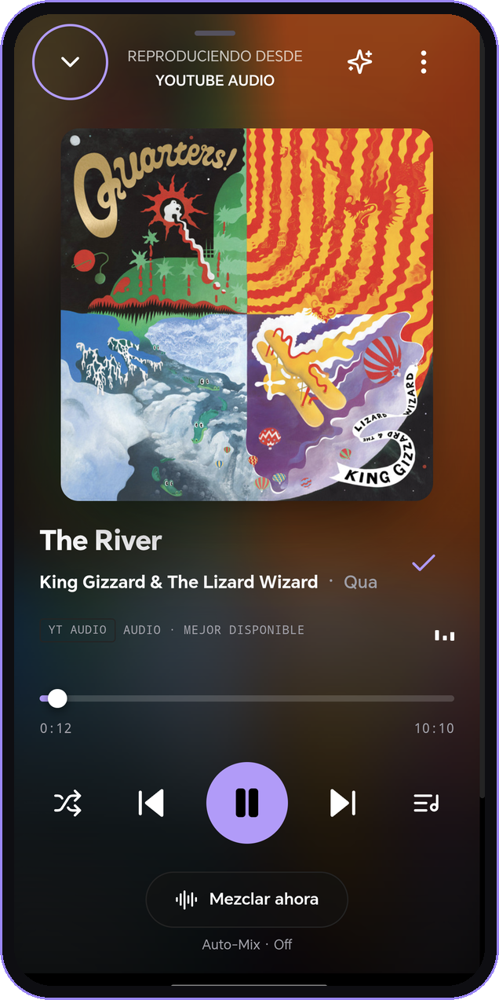

  <a href="https://armando-trejo.github.io/murmur/">
    <picture>
      <source media="(max-width: 600px)" srcset="docs/assets/hero-movil.svg">
      
    </picture>
  </a>

  
  &nbsp;
  
  &nbsp;
  

  
  
  

## Qué es MURMUR

MURMUR junta en una sola app la música que tienes en **Spotify** y en **YouTube Music**. Buscas una vez, armas una sola cola y escuchas en un reproductor oscuro y cuidado, hecho para pantallas AMOLED. Funciona en el teléfono, en el coche con Android Auto y con la voz.

  

## Funciones principales

- **Spotify dentro de MURMUR.** Suena desde Spotify sin abrir su app; si una canción falla, MURMUR pone la misma grabación de YouTube Music.
- **YouTube Music con tu cuenta.** Tus playlists, mixes, álbumes y recomendaciones.
- **Inicio que se renueva.** Desliza hacia abajo y «Para ti» cambia: secciones según el ánimo, otras canciones al frente y otras de tus favoritas de Spotify.
- **JAM.** Tus amigos escanean un QR y, desde su navegador y sin instalar nada, buscan, añaden y ordenan canciones en tu cola. Lo que pongan no cambia tus recomendaciones, salvo que tú le des ♥.
- **Compartir.** Manda el enlace de la canción de YouTube Music o de Spotify, según dónde esté.
- **La música no se detiene.** Después de una canción suelta vienen 15 afines, empezando por las que sueles poner después. Aleatorio trae otras 15 y la cola se rellena sola.
- **Voz «Ok MURMUR».** Pide una canción, un artista o un mix sin tocar la pantalla. Entiende pedidos vagos como YouTube: «iwachu» es «Chop Suey!».
- **Android Auto.** Tu biblioteca y tus mixes en la pantalla del coche.
- **Letras sincronizadas.** La línea que suena se ilumina; toca una para saltar a ese momento.
- **Pantalla musical.** Un visualizador que se mueve con el audio y los colores de la portada.
- **Widget.** Controla lo que suena desde la pantalla de inicio.
- **Descargas inteligentes.** Guarda lo que más escuchas solo cuando estás en Wi‑Fi, para oírlo sin datos.
- **Se actualiza sola.** La app te avisa cuando hay versión nueva y la instala desde adentro.

## Instálala en 3 pasos

1. **Descarga el APK.** Abre este enlace desde tu teléfono Android: [Descargar MURMUR.apk](https://github.com/Armando-Trejo/murmur/releases/latest/download/MURMUR.apk).
2. **Permite la instalación.** Android te pedirá permiso para instalar apps de origen desconocido desde tu navegador o tu gestor de archivos. Actívalo solo para esa app y vuelve.
3. **Abre MURMUR y conecta tus cuentas.** La app te lleva paso a paso. Las siguientes versiones las instalas desde la propia app.

> Requiere Android 8.0 o posterior en un teléfono de 64 bits (prácticamente todos los de los últimos años).

## Conecta tus cuentas

**YouTube Music.** Inicias sesión dentro de MURMUR con tu cuenta de Google, igual que en la web. Con eso aparecen tu biblioteca, tus mixes y tus recomendaciones.

**Spotify.** Spotify pide que cada persona use su propia llave de desarrollador (es gratis, pero Spotify solo se la da a cuentas Premium). La app te guía paso a paso, con botones para copiar cada dato:

1. Entras a [developer.spotify.com](https://developer.spotify.com/dashboard) con tu cuenta de Spotify y creas una app.
2. Llenas el formulario con los datos que MURMUR te deja listos para copiar.
3. Pegas el **Client ID** en MURMUR y autorizas.

Tus canciones de Spotify suenan **desde Spotify, dentro de MURMUR**: no necesitas tener abierta ni instalada la app de Spotify, y siguen sonando con la pantalla apagada. Si alguna no se puede reproducir, MURMUR pone la misma grabación desde YouTube Music para que la música no se detenga. Sin cuenta de Spotify puedes buscar y escuchar cualquier canción igual.

## En el coche con Android Auto

Como MURMUR no viene de Play Store, Android Auto la oculta hasta que lo permites una vez:

1. En el teléfono abre **Ajustes de Android Auto**.
2. Baja hasta **Versión** y tócala **10 veces** seguidas. Acepta el aviso para activar los ajustes de desarrollador.
3. En el menú de tres puntos entra a **Ajustes para desarrolladores** y activa **Fuentes desconocidas**.
4. Conecta el teléfono al coche. MURMUR aparece junto a tus otras apps de música.

## Privacidad

Todo se guarda en tu teléfono: tus sesiones, tu llave de Spotify, tu historial y tus descargas. **Ninguna cuenta ni dato pasa por servidores de MURMUR**, porque MURMUR no tiene servidores. La app habla directo con Spotify, YouTube Music y los servicios de letras.

  <a href="https://github.com/Armando-Trejo/murmur/releases"><b>Novedades de cada versión</b></a>
  &nbsp;·&nbsp;
  <a href="https://armando-trejo.github.io/murmur/"><b>Página de MURMUR</b></a>
  &nbsp;·&nbsp;
  <a href="docs/DESARROLLO.md"><b>Compilar y desarrollar</b></a>

MURMUR es un proyecto independiente. No está afiliado a Spotify ni a Google. Spotify y YouTube Music son marcas de sus respectivos dueños.

